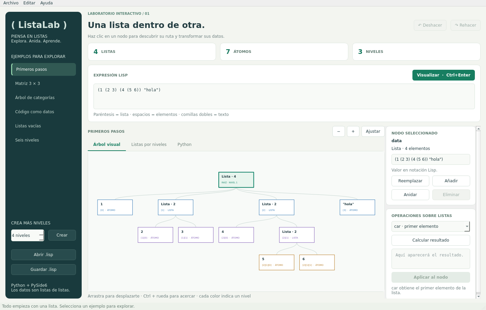
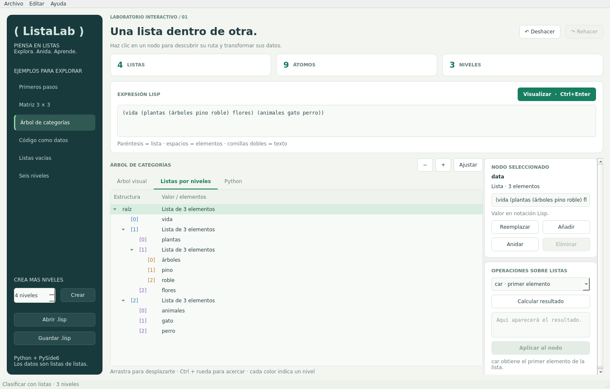

# ( ListaLab )

**Una lista dentro de otra.** Aplicación de escritorio educativa con **Python y PySide6** para crear, visualizar y transformar listas anidadas, inspirada en la forma en que Lisp representa datos y expresiones.



## Ejecutar

Necesitas **Python 3.10 o superior** y un escritorio gráfico. Funciona como aplicación local, sin servidor ni claves de API.

```bash
git clone https://github.com/marting07/listalab.git
cd listalab
python -m venv .venv
```

Activa el entorno:

```bash
# Linux / macOS
source .venv/bin/activate

# Windows PowerShell
.venv\Scripts\Activate.ps1
```

Instala y abre la aplicación:

```bash
python -m pip install -e .
python -m listalab
```

También puedes ejecutarla con el comando `listalab` después de instalarla. En algunos Linux el ejecutable de Python se llama `python3`.

## Qué puedes hacer

- Explorar seis ejemplos: listas de tres niveles, una matriz, categorías, código como datos, listas vacías y una estructura de seis niveles.
- Generar listas de **1 a 6 niveles** con un botón.
- Escribir una expresión Lisp y visualizarla en un árbol interactivo, en una vista desplegable por niveles o como listas de Python.
- Seleccionar cualquier nodo y ver su ruta, como `data[2][1]`.
- Reemplazar nodos, añadir al final, envolver en una nueva lista o eliminar elementos.
- Calcular `car`, `cdr`, `cons`, `reverse` y `flatten`, ver el resultado y aplicarlo al nodo seleccionado.
- Deshacer y rehacer hasta 50 cambios de datos.
- Abrir y guardar documentos UTF-8 con extensión `.lisp`.



## Una prueba rápida

1. Abre **Primeros pasos**. La expresión inicial es `(1 (2 3) (4 (5 6)) "hola")`.
2. Selecciona el nodo `(4 (5 6))`: su ruta es `data[2]`.
3. Elige **flatten** y pulsa **Calcular resultado**: verás `(4 5 6)`.
4. Pulsa **Aplicar al nodo** para sustituir únicamente esa sublista.
5. Usa **Deshacer** para recuperar la estructura anterior.

Para construir otra lista, escribe, por ejemplo:

```lisp
; Una matriz: cada fila es otra lista.
((1 2 3) (4 5 6) (7 8 9))
```

O representa una expresión simbólica:

```lisp
(define (cuadrado x) (* x x))
```

La aplicación representa esa expresión como datos; no ejecuta un intérprete Lisp.

## Las listas son la estructura principal

El documento de trabajo es una **`list` de Python que contiene átomos y otras `list`**, sin un árbol de objetos como almacenamiento alternativo:

```python
data = [1, [2, 3], [4, [5, 6]], "hola"]
data[2][1]  # [5, 6]
```

Las rutas son listas de índices. El catálogo de ejemplos también es una lista de listas, con filas `[título, descripción, datos]`. El historial guarda una lista de instantáneas de listas. Los elementos gráficos de Qt se reconstruyen a partir del documento cada vez que cambian los datos.

La recursión se usa para recorrer, serializar, contar y dibujar las sublistas. Las operaciones devuelven copias, de modo que un resultado o un cambio no altere accidentalmente los ejemplos o el historial.

### Operaciones

Para la lista `(1 (2 3) 4)`:

| Operación | Resultado | Comportamiento |
| --- | --- | --- |
| `car` | `1` | Primer elemento, que puede ser un átomo o una sublista. |
| `cdr` | `((2 3) 4)` | Resto de la lista. |
| `cons`, argumento `(a b)` | `((a b) 1 (2 3) 4)` | Inserta un elemento al inicio, conservando su anidación. |
| `reverse` | `(4 (2 3) 1)` | Invierte el nivel seleccionado. |
| `flatten` | `(1 2 3 4)` | Reúne los átomos de todos los niveles; omite listas vacías. |

La raíz siempre debe ser una lista. Un resultado atómico de `car` se puede consultar; solo se puede aplicar si el nodo seleccionado no es la raíz. `car` y `cdr` sobre `()` devuelven `()`.

### Sintaxis admitida y diferencias con Lisp

- Paréntesis para listas; espacios entre átomos.
- Enteros, decimales finitos y notación exponencial.
- Símbolos sin comillas, como `cuadrado`, y cadenas con comillas dobles, como `"hola mundo"`.
- Las cadenas usan escapes JSON: `\n`, `\"`, `\\`, etc.
- Booleanos `#t` y `#f`; `nil` se convierte en `None`.
- Comentarios desde `;` hasta el final de la línea y una comilla inicial opcional: `'(1 (2 3))`.
- Se admite una expresión por documento; no hay evaluación, macros, pares punteados ni lectura de código Python.

Es una herramienta inspirada en Lisp, con listas dinámicas de Python en lugar de celdas cons enlazadas. Para hacer visibles los distintos tipos, **`nil` y `()` se representan por separado**; en Common Lisp designan el mismo valor. La sintaxis booleana sigue la convención de Scheme. `flatten` es una operación educativa adicional.

`Symbol` es una subclase de `str` que permite conservar la diferencia entre `hola` y `"hola"` al guardar. En la pestaña Python ambos se muestran con comillas por su representación de cadena; las vistas Lisp conservan la distinción.

## Controles y archivos

| Acción | Control |
| --- | --- |
| Visualizar el editor | `Ctrl+Enter` |
| Abrir / guardar | `Ctrl+O` / `Ctrl+S` |
| Deshacer / rehacer datos | Botones o `Ctrl+Alt+Z` / `Ctrl+Alt+Y` |
| Deshacer texto del editor | `Ctrl+Z` |
| Acercar / alejar el árbol | Botones o `Ctrl` + rueda |
| Desplazar el árbol | Arrastrar o barras de desplazamiento |
| Guía rápida | `F1` |

Visualiza los cambios del editor antes de editar nodos, abrir ejemplos o guardar. Los errores conservan el último documento válido. Los archivos de [examples/](examples/) pueden abrirse directamente en la aplicación. Guardar conserva símbolos y tipos en notación Lisp, sin los comentarios o el formato original. El historial es temporal y no hay guardado automático.

La métrica **niveles** cuenta únicamente la profundidad de listas, incluida la raíz. Los colores del árbol indican la profundidad visual de cada nodo. Para mantener una interfaz manejable se admiten hasta **12 niveles de listas, 500 nodos y 32 000 caracteres** por documento. El generador ofrece hasta seis niveles; el editor admite los doce.

## Desarrollo y verificación

```bash
python -m pip install -e ".[dev]"
python -m pytest -q
```

Las pruebas de interfaz usan widgets y eventos Qt reales con `QT_QPA_PLATFORM=offscreen`, sin necesitar una pantalla. Verifican selección por clic en el diagrama, edición, operaciones, historial, lectura/escritura, ejemplos y entradas inválidas. GitHub Actions ejecuta las pruebas en Linux y Windows con Python 3.10 y 3.12.

En un Linux mínimo pueden hacer falta las bibliotecas del sistema de Qt. En Ubuntu/Debian: `sudo apt-get install libegl1 libopengl0 libxcb-cursor0`. El modo `offscreen` sirve para pruebas; para usar la app necesitas una sesión gráfica.

```text
listalab/
  model.py       Parser, listas anidadas, operaciones e historial; sin Qt
  diagram.py     Árbol interactivo derivado de las listas
  app.py         Ventana, acciones y archivos
  style.py       Apariencia de la interfaz
examples/        Documentos Lisp listos para abrir
tests/           Pruebas del modelo y la interfaz
docs/            Capturas reales de la app
```

Licencia [MIT](LICENSE).
